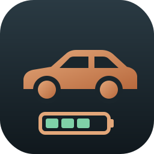
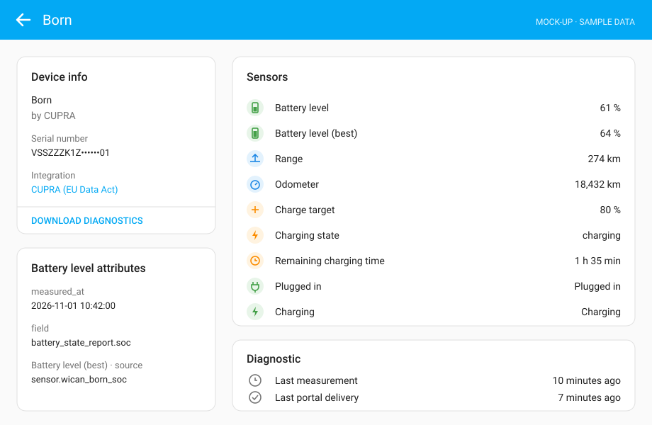
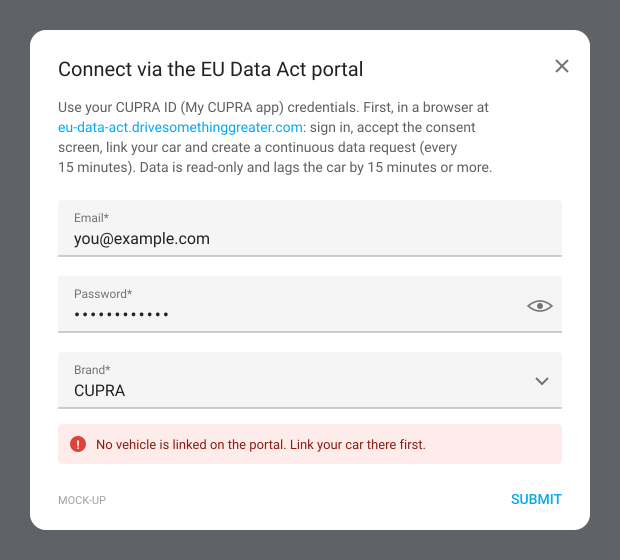
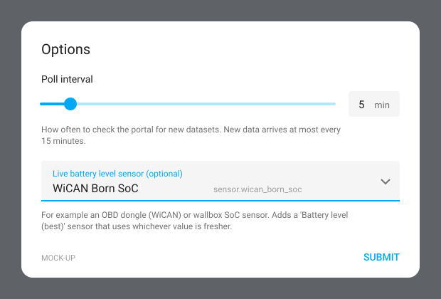
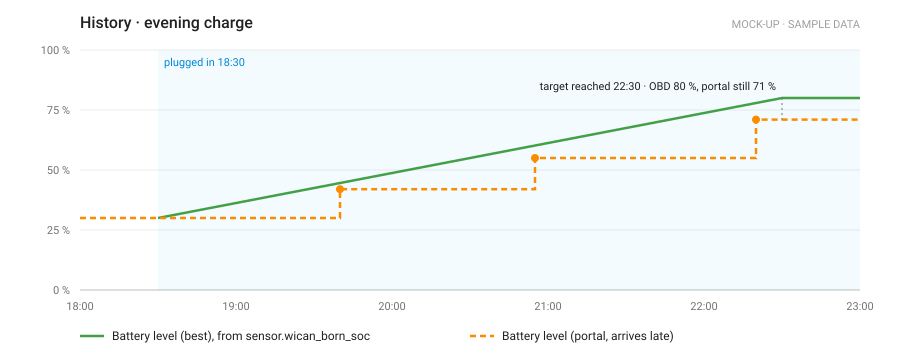
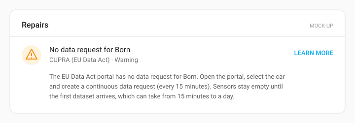

# CUPRA (EU Data Act) for Home Assistant

Read-only CUPRA vehicle data in Home Assistant, sourced from the VW Group **EU Data Act portal**.
It replaces the archived `cupra_we_connect`, whose app API now requires device attestation.
[STRATEGY.md](STRATEGY.md) explains the background and the options.

**What you get:** battery level, range, odometer, charge target, charging state, plugged in / charging,
remaining charge time, and the time of the last measurement and the last portal delivery. You can
optionally add a "Battery level (best)" sensor that blends in a live local SoC, for example from an
OBD dongle.

**What you don't get:** remote commands (climate, lock, charging). Live data is not available either:
the portal updates at most every 15 minutes, and often less often.

<p align="center">
  
</p>

> The screenshots in this README are illustrative mock-ups with sample values, not captures from a real car.

## 1. One-time setup on the portal (required)

1. Open https://eu-data-act.drivesomethinggreater.com and sign in with your CUPRA ID (My CUPRA app login).
2. Accept the consent screen and link your car. You must be its primary user.
3. Create a **continuous** data request (every 15 minutes). Don't create a one-time export first,
   because only one request can be active at a time.
4. Wait for the first dataset. This takes anywhere from 15 minutes to a day.

## 2. Install

HACS: add this repository as a custom repository (category: Integration), then install **CUPRA (EU Data Act)**.
Manual: copy `custom_components/cupra_dataact` into your HA `config/custom_components/` and restart.

Then go to Settings → Devices & services → Add integration → **CUPRA (EU Data Act)** and sign in
with your CUPRA ID. Each car linked on the portal becomes a device.

<p align="center">
  
</p>

## 3. Options

Open the integration and choose **Configure** to set:

- **Poll interval:** how often to check the portal for new datasets (default 5 minutes, minimum 2).
  Polling more often than every 15 minutes only shortens the wait after VW publishes a dataset.
- **Live battery level sensor:** any battery sensor in Home Assistant, such as an OBD dongle
  (WiCAN over MQTT) or your wallbox. This adds **Battery level (best)**, which shows whichever reading
  is newer and names its source in the `source` attribute.

<p align="center">
  
</p>

The live sensor is what makes the integration usable while charging. The portal value arrives in
late steps, while the OBD reading tracks the car:

<p align="center">
  
</p>

## Sensors

| Entity (for a car named Born) | Example | Notes |
|---|---|---|
| `sensor.born_battery_level` | 61 % | From the portal |
| `sensor.born_battery_level_best` | 64 % | Only with a live battery sensor configured |
| `sensor.born_range` | 274 km | |
| `sensor.born_odometer` | 18,432 km | |
| `sensor.born_charge_target` | 80 % | |
| `sensor.born_charging_state` | charging | Raw portal value |
| `sensor.born_remaining_charging_time` | 95 min | |
| `sensor.born_charge_power` | 7.2 kW | Disabled by default; the portal sometimes reports duplicates |
| `binary_sensor.born_plugged_in` | on | |
| `binary_sensor.born_charging` | on | |
| `sensor.born_last_measurement` | 10 minutes ago | Diagnostic: when the car last sent data |
| `sensor.born_last_portal_delivery` | 7 minutes ago | Diagnostic: when the portal last published a file, even an empty one |

Every value sensor has a `measured_at` attribute (when the car measured it) and a `field` attribute
(which portal field it came from).

## Check your account without Home Assistant

```sh
uv run python tools/probe.py you@example.com   # add --all to dump every data point
```

## Troubleshooting

- **Repair "No data request"**: step 1.3 is missing or has expired.

  

- **`Last portal delivery` is recent but `Last measurement` is old**: the portal is running, but the car
  isn't sending data, or VW is delivering empty files (a known issue, Oct 2026).
- **Login stops at a consent page**: sign in on the portal in a browser once and accept.
- **Unmapped fields**: download diagnostics from the device page. They list every raw data point, with
  location values redacted.

## Development

The project uses [uv](https://docs.astral.sh/uv/) for dependencies and [ruff](https://docs.astral.sh/ruff/) for linting and formatting. Tool versions are pinned in `pyproject.toml` and `uv.lock`.

```sh
uv sync                                    # Python 3.13 venv with the pinned test and lint tools
uv run pytest                              # all tests, offline
uv run ruff check . && uv run ruff format --check .
uv run python tools/gen_tests_readme.py    # regenerate tests/README.md after changing tests
```

[tests/README.md](tests/README.md) lists every test, what it checks and links to each assert. GitHub Actions runs ruff, the tests and a check that the test README is up to date on every pull request and push to `main`.

The integration icon is drawn in `docs/brand/icon.svg`. Home Assistant 2026.3 and later show the PNGs in
`custom_components/cupra_dataact/brand/`. After you edit the SVG, regenerate them with:

```sh
uv run --with cairosvg python -c "import cairosvg; [cairosvg.svg2png(url='docs/brand/icon.svg', write_to=f'custom_components/cupra_dataact/brand/{n}', output_width=s, output_height=s) for n, s in [('icon.png', 256), ('icon@2x.png', 512)]]"
```

The portal protocol lives in `custom_components/cupra_dataact/api.py`, which has no HA imports.
It mirrors evcc's `vehicle/vw/eudataact`, so check that project when VW changes something.
